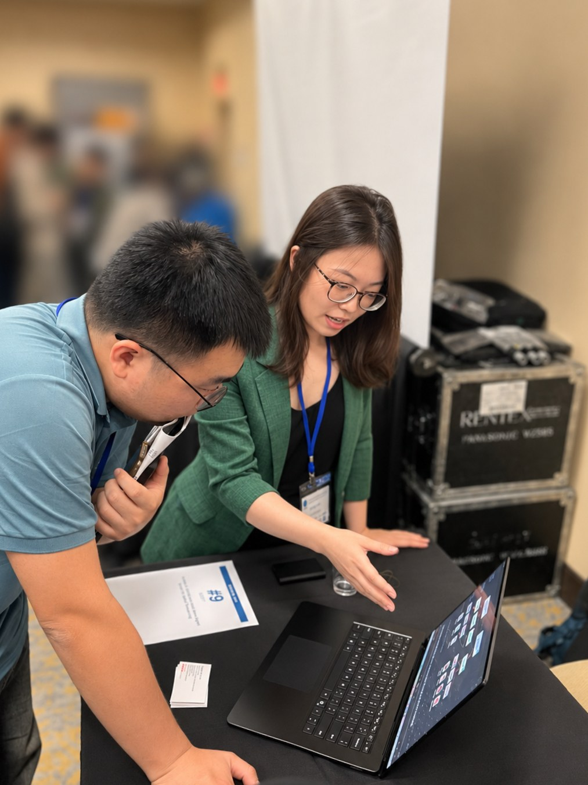

**At the 34th ACM SIGSPATIAL conference in Riverside, California, I presented our demo paper, *GridMind: A DGGS-Grounded Multi-Agent System for Spatial Reasoning*, in the demo session.** [View the poster](/assets/pdf/posters/GridMind_SIGSPATIAL2026_poster.pdf) · [Read the paper](/assets/pdf/papers/2026_SIGSPATIAL_Li_GridMindDGGSMultiAgentSpatialReasoning_published.pdf)

GridMind uses a Discrete Global Grid System as a persistent substrate for spatial reasoning: adjacency, containment, and hierarchy are derived from rHEALPix cell identifiers rather than inferred by the language model. Visitors to the stand worked through the live system themselves, placing sensors in the oil-and-gas sandbox, replaying leak and wildfire events, watching which agents woke up, and asking those agents why they acted as they did.

The questions were the most useful part. Several focused on where the boundary between deterministic code and model reasoning should sit, and on how the approach carries over to domains beyond methane and wildfire. Others pushed on scale and on line features such as roads and pipelines, which the current cell-and-feature model does not yet handle well. Those conversations have already shaped what I want to build next.

---

***I am recruiting graduate students to join my research group at the University of Guelph, starting December 2026. If you work on GeoAI, DGGS, agentic AI, or geospatial intelligence, I would be glad to hear from you.***
